<!-- 

    

  
    
    

 -->

  
  
  
  <!--  -->

 

## 👋 About Me

- **Early Career Focus:** Built software solutions for IoT systems and integrated data models for AI applications.

- **Current Passion:** Designing and deploying custom Discord bots for automation, community engagement, and API integrations.

- **Goals:** Combining smart IoT edge devices with conversational interfaces (like Discord) powered by machine learning algorithms.

- **Fun fact:** enjoying the freelancer lifestyle lately!  
I get a new energy whenever an interesting project comes my way, whether it's from long-term clients or new agencies.  
I love the variety, the challenges, and the occasional "wait, how does this work?" moment. 😄

 

<table>          
<tr>    
<td width="70%">

I'm a Software Engineer who enjoys building things, solving problems, and occasionally convincing code to behave. I have a solid foundation in AI and IoT, along with hands-on experience developing custom Discord bots and automation tools.

I'm comfortable working with APIs, backend systems, real-time data, and asynchronous programming. I enjoy learning new technologies, tackling interesting challenges, and turning ideas into practical applications. Always curious, always improving, and always happy to make something work a little smarter.

</td>
<td width="30%">

</td>
</tr>
</table>

## 🐙 Galaga Preview

<picture>
    
</picture>

---

 

<!--skils-->

## 🛠️ Tech Stack

<h4>💻 Languages</h4> 
      
 <h4>💬 Discord & Real-Time Frameworks</h4> 
      
 <h4>🤖 AI Integration & Automation</h4> 
          
 <h4>⚙️ Backend & Databases</h4> 
        
 <h4>☁️ Infrastructure & DevOps</h4> 
         

## ☕ Support My Work

<table align="center">          
<tr>    

<td align="center" width="60%">

</td>
<td align="center" width="40%">

</td>
</tr>
</table>

<!--bog`lanish-->

## 📩 Connect With Me

  
  &nbsp;&nbsp;&nbsp;
  
  &nbsp;&nbsp;&nbsp;
   
  &nbsp;&nbsp;&nbsp;
  

